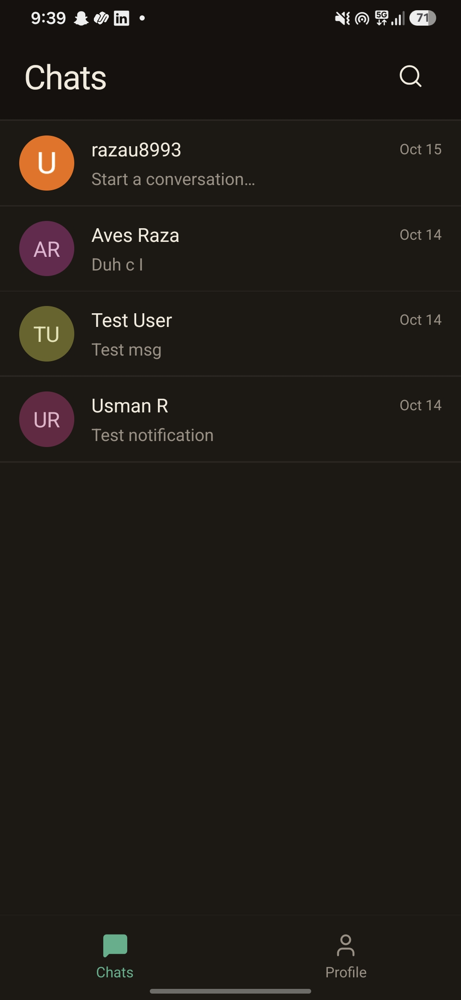
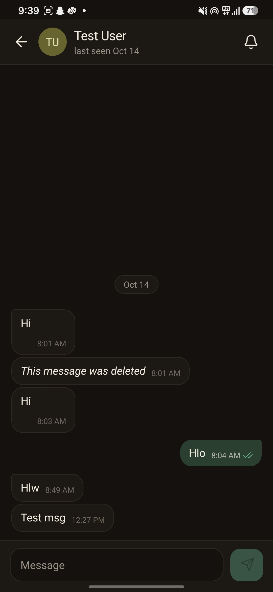
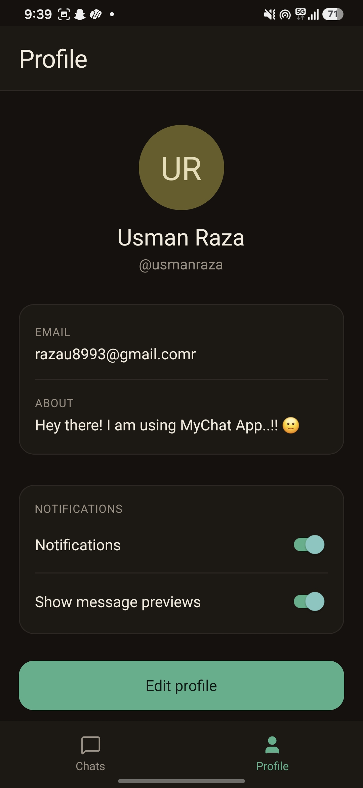

# MyChat

A realtime one-to-one chat app for Android, built with React Native (CLI) and Supabase.


## Screenshots

<!-- Replace these with your own screenshots. Put the images in a /docs folder. -->
| Chats | Conversation | Profile |
| :---: | :---: | :---: |
|  |  |  |

## Features

- Email and password authentication with persistent sessions
- User profiles with unique usernames
- One-to-one conversations, created on demand without duplicates
- Realtime messaging powered by Supabase Realtime
- Chat list with last message, time, and unread count
- Message status: sending, sent, delivered, and read
- Typing indicator and online status
- Day separators (Today, Yesterday, full date)
- Push notifications for new messages, even when the app is closed
- Light and dark mode that follows the system setting
- Row Level Security on every table, so users can only access their own chats

## Tech stack

| Area | Technology |
| --- | --- |
| App | React Native CLI (bare workflow, no Expo), JavaScript |
| Backend | Supabase (Postgres, Auth, Realtime, Edge Functions) |
| Push notifications | Firebase Cloud Messaging with Notifee |
| Navigation | React Navigation |

## How push notifications work

```
New row in messages
  → database trigger calls the send-push Edge Function
  → the function looks up the recipient's device tokens
  → Firebase Cloud Messaging delivers the notification
  → tapping it opens the right conversation
```

## Getting started

### Prerequisites

- Node.js 18 or later
- JDK 17
- Android Studio with the Android SDK, and `ANDROID_HOME` set
- A [Supabase](https://supabase.com) project
- A [Firebase](https://console.firebase.google.com) project with an Android app registered as `com.mychat`

### 1. Clone and install

```bash
git clone https://github.com/Usman-raza05/MyChat.git
cd MyChat
npm install
```

### 2. Set up Supabase

1. Create a new Supabase project.
2. Open the SQL Editor and run the SQL scripts for the tables, policies, functions, and triggers. Make sure Row Level Security is enabled on every table.
3. Turn on Realtime for the `messages` table.
4. Copy your **Project URL** and **publishable key** from Project Settings → API.
5. Add them to the Supabase client file (`src/lib/supabase.ts`).

> Use only the publishable key in the app. Never put a secret or `service_role` key in client code.

### 3. Set up Firebase

1. Register an Android app in Firebase with the package name `com.mychat`.
2. Download `google-services.json` and place it in `android/app/`.
3. Generate a service account key under Project Settings → Service accounts. You will store it as a Supabase secret in the next step, not in the app.

### 4. Deploy the push notification function

```bash
npx supabase login
npx supabase link --project-ref <your-project-ref>

npx supabase secrets set --env-file .env.secrets
npx supabase functions deploy send-push --no-verify-jwt
```

`.env.secrets` needs two values:

```
FIREBASE_SERVICE_ACCOUNT=<contents of the service account JSON, on one line>
WEBHOOK_SECRET=<a long random string>
```

Then create the database trigger that calls the function on every new message, using the same `WEBHOOK_SECRET` value in the request header.

### 5. Fonts and icons

Place the font files in `assets/fonts/` and link them:

```bash
npx react-native-asset
```

### 6. Run the app

```bash
npx react-native start
npx react-native run-android
```

## Building a release APK

```bash
cd android
./gradlew assembleRelease
```

The APK is created at `android/app/build/outputs/apk/release/app-release.apk`.

For public distribution, sign the app with your own keystore instead of the debug key.

## Project structure

```
src/
  components/    Reusable UI (icons, bubbles, avatars)
  context/       Auth and app state
  lib/           Supabase client and notification helpers
  screens/       App screens
  strings.js     All user-facing text
  theme.js       Colors, fonts, spacing
supabase/
  functions/
    send-push/   Edge Function that sends push notifications
android/         Native Android project
```

## Security notes

- Row Level Security is enabled on all tables.
- Firebase service account keys and the webhook secret live in Supabase Secrets only.
- `.env.secrets`, service account files, and keystores are listed in `.gitignore`. Do not commit them.

## Roadmap

- [ ] Group chats
- [ ] Image and file sharing
- [ ] Phone number login
- [ ] iOS support

## Contributing

Issues and pull requests are welcome. For larger changes, open an issue first to discuss what you'd like to change.

## License

